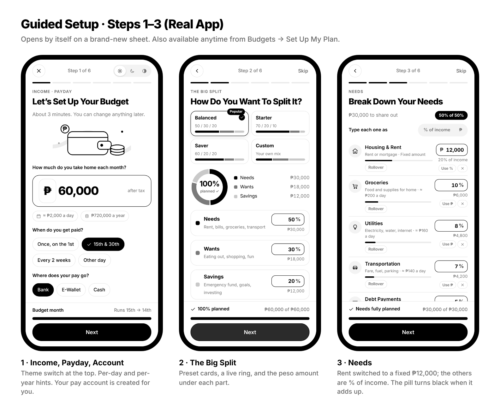
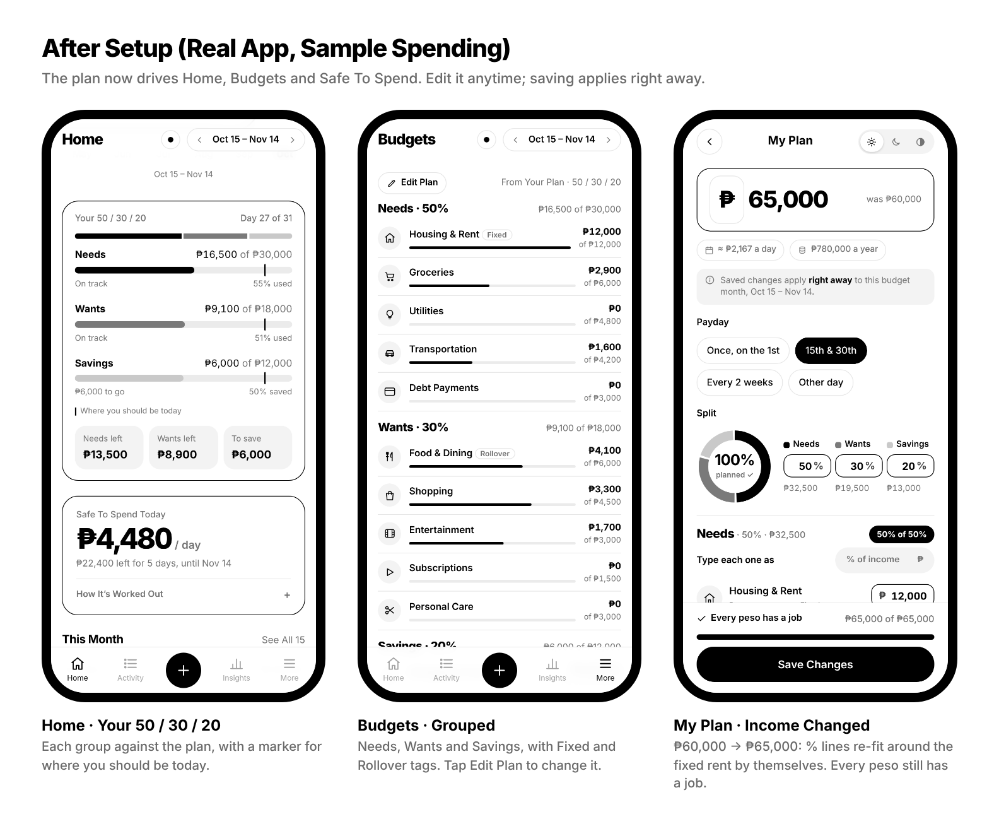
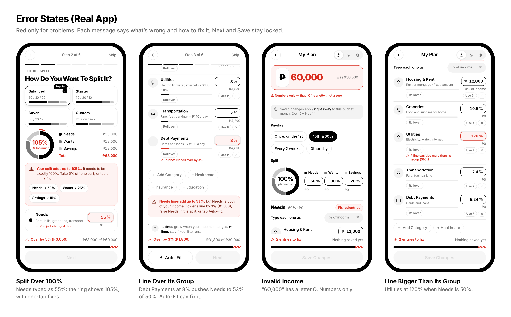

<p align="center"></p>

<h1 align="center">badyet</h1>
<p align="center">A minimal, black-and-white budget app that stores everything in your own Google Sheet.</p>

<p align="center"></p>

## What it does

- **Guided setup:** on a brand-new sheet, six short steps build your whole budget: take-home pay and payday, a Needs / Wants / Savings split (like 50 / 30 / 20), then each category as a % of income or a fixed peso amount. Clear error messages, one-tap fixes and Auto-Fit make sure every peso has a job. One big switch types every amount as % or ₱ at once (debts always stay in ₱), and tapping a line's icon lets you pick a different one; it's saved in the sheet.
- **My Plan, editable anytime:** change your income or any line. % lines grow with your income; fixed amounts like rent stay put. Saving applies to this month right away. The plan also lives in the sheet's Plan tab.
- **Your 50 / 30 / 20 on Home:** each group against your plan, with a marker for where you should be today.
- **Safe to spend today:** one number on Home showing what you can spend per day without missing a bill or a savings goal.
- **Quick add:** a number keypad, category chips and a date strip, for entering a purchase in seconds.
- **Category memory:** type a place you've used before (like "Jollibee") and the app picks the same category and account as last time.
- **Budgets with rollover:** money you didn't spend can carry into next month, and overspending comes off next month.
- **Debts & 4 Tanks:** debts sit inside your Needs share. Split any debt into monthly payments, track what you've paid, and it disappears from the plan once paid off. Home shows Needs, Wants, Debts and Savings as four tanks you can tap.
- **Payday months:** budgets can run payday to payday (for example the 15th to the 14th) instead of the calendar month.
- **PIN lock:** new devices need a 4 to 8 digit PIN, checked on Google's side.
- **Accounts (optional):** turn them on in Settings and friends can sign up with a username, email and password. A 6-digit code is emailed to verify the email (one account per email). Each person gets their own private budget sheet, shared to their email. You stay the admin and your sheet stays yours. Passwords are never stored, only a salted hash.
- **Activity, insights, forecast, goals, debt, bills and accounts.**
- **Light, dark or auto theme.** Works on phones and computers.
- **Two-way sync with Google Sheets.** Edits in the app reach the sheet within a second, and edits in the sheet show up in the app within about 15 seconds.

Amounts are in Philippine pesos (₱).

<p align="center"></p>

<p align="center"></p>

## Install it on your phone

This repository also serves Badyet as an installable app through GitHub Pages (`index.html`, `manifest.webmanifest`, `sw.js`).

1. Set up your sheet and web app first (see **Set it up** below).
2. On GitHub: **Settings → Pages → Build and deployment → Source: Deploy from a branch → Branch: main, folder / (root) → Save**. After a minute or two the app is live at `https://<your-username>.github.io/<this-repo>/`.
3. Open that page on your phone and paste your web app link (ending in `/exec`) once. It is saved only on that device.
4. Install it: in Chrome tap **⋮ → Install app** (or **Add to Home screen**). On iPhone, in Safari tap **Share → Add to Home Screen**.

The installed app opens full screen and works offline with your last-synced data.

## How it works

The whole app runs as a Google Apps Script web app attached to a Google Sheet:

```
apps-script/
  Code.gs          bridge between the app and the sheet (also builds and tidies the tabs)
  Index.html       the app itself (built from src/)
  DemoData.gs      optional: fills the sheet with six months of sample data
  appsscript.json  project settings (web app access, time zone)
index.html         the installable app that GitHub Pages serves (built from src/)
config.js          optional built-in web app link (keep it empty in a public repo)
manifest.webmanifest, sw.js   what lets phones install it and open it offline
src/               the app's source, split into readable parts
scripts/build.sh   rebuilds apps-script/Index.html, index.html and sw.js from src/
assets/            app icons
docs/              screenshots
```

The sheet uses linked tabs: Guide, Plan (including Debts and the icon you picked), Transactions, Accounts, Expense Categories, Income Categories, Budgets, Bills, Goals, Lists and Settings. Records link to each other by ID, such as `TXN-3F9K2A` or `ACC-7B21C4`, so renaming an account or category updates every row that uses it.

## Set it up (about 5 minutes)

1. Create a new, empty Google Sheet.
2. Open **Extensions → Apps Script**.
3. Paste the contents of `apps-script/Code.gs` into `Code.gs`.
4. Click **+ → HTML**, name the file `Index`, and paste in `apps-script/Index.html`.
5. Optional: click **+ → Script**, name it `DemoData`, and paste in `apps-script/DemoData.gs`.
6. Save, then go to **Deploy → New deployment → Web app** and set:
   - **Execute as:** Me
   - **Who has access:** Anyone
7. Click **Deploy** and allow the permissions it asks for.
8. Open the web app link. That link is your app. Bookmark it, or add it to your phone's home screen.
9. Back in the sheet, reload the page and click **Badyet → Tidy up layout & look**.
10. Recommended: in the app, go to **Settings → PIN Lock** and set a PIN.

When you change the code later, publish the change with **Deploy → Manage deployments → pencil → Version: New version → Deploy**. The link stays the same.

## Privacy

- **Your data never lives in this repository.** It stays in your own Google Sheet, under your Google account.
- **Turn on the PIN lock.** Without it, anyone who has your web app link can open your app.
- **With accounts on**, the list lives in a separate "Badyet Accounts" sheet in the owner's Drive, codes expire after 10 minutes, and 5 wrong passwords pause login for 5 minutes. As the owner you can technically open everyone's sheets, so only invite people who trust you.
- **The PIN is never stored.** Only a salted hash is kept in the script's private properties, not in the sheet. Forgot it? Use **Badyet → Remove app PIN** in the sheet.
- **Don't commit `.clasp.json`, backups or exports.** The `.gitignore` already excludes them.

## Editing the app

Change the files in `src/`, then rebuild the app file:

```bash
bash scripts/build.sh
```

Paste the new `apps-script/Index.html` into Apps Script and publish a new version. Upload the new `index.html` and `sw.js` to GitHub too, so the installed app updates.
